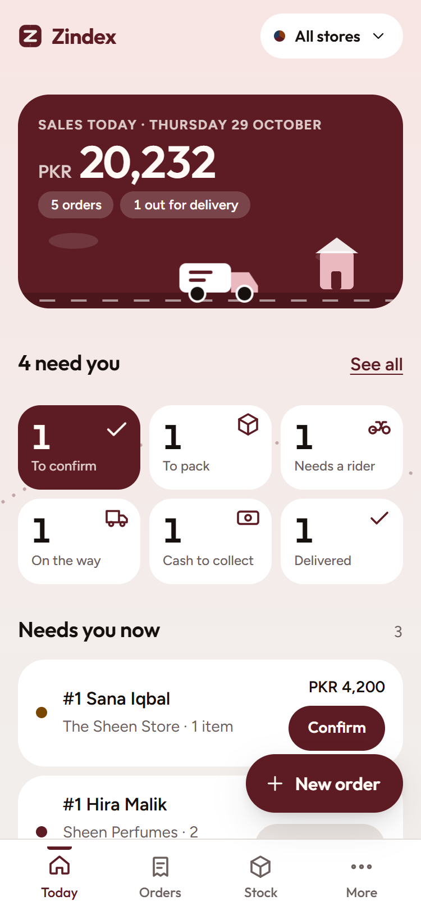
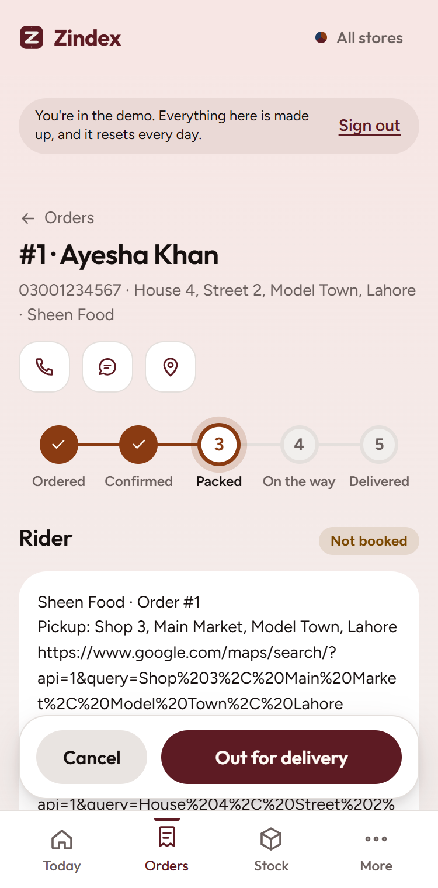
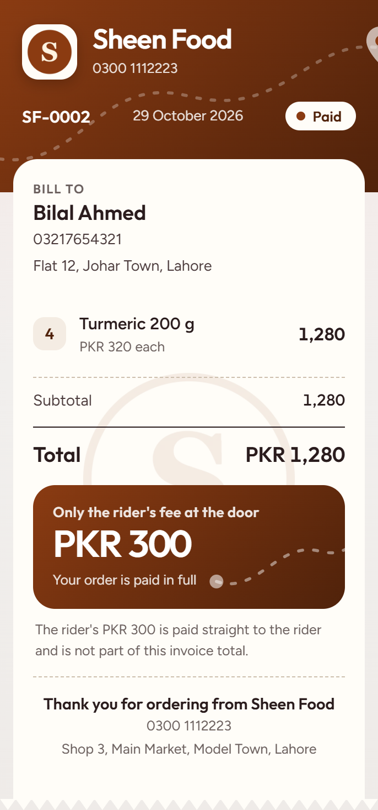
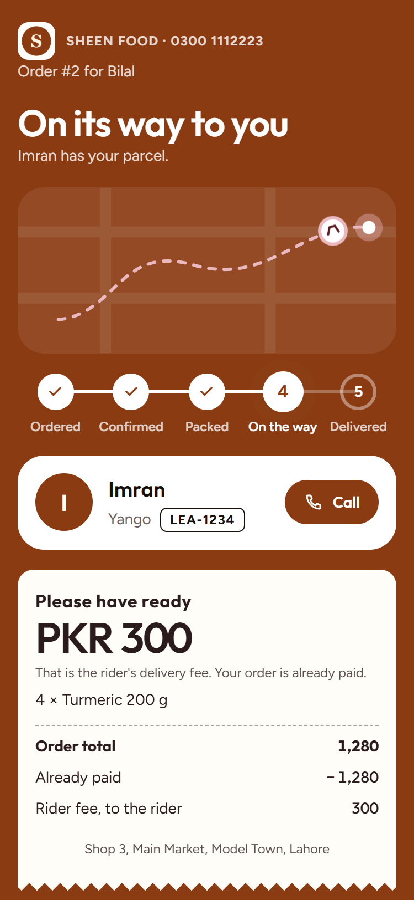
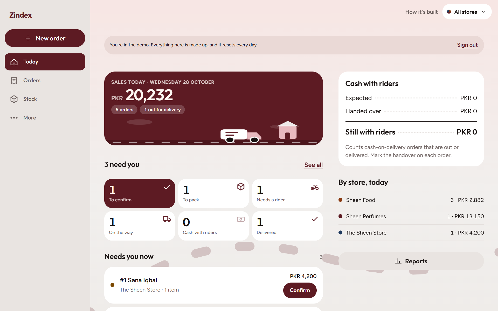
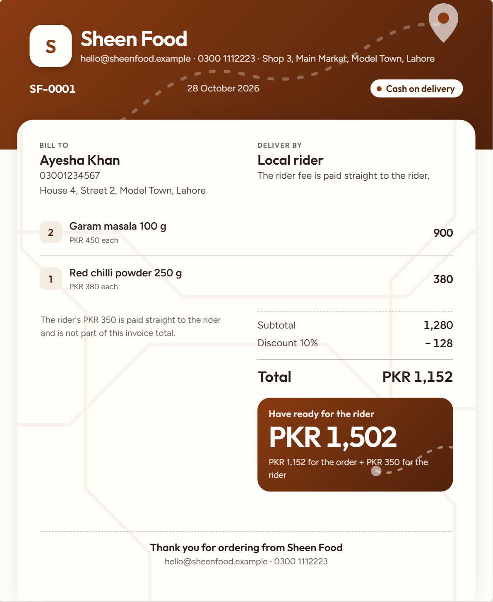
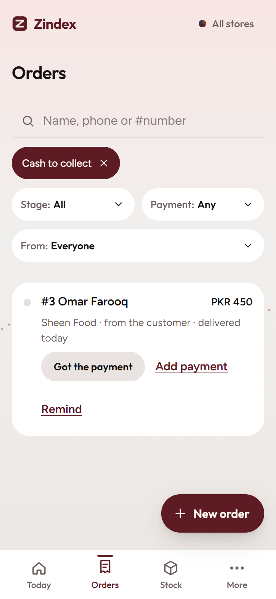
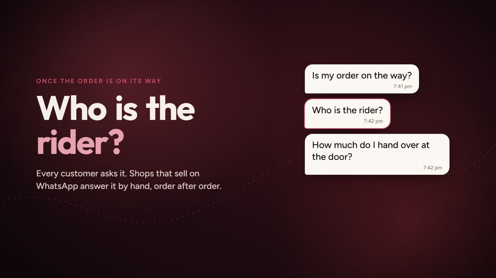

# Zindex

**Orders, invoices, stock and delivery cards for shops that sell on WhatsApp.**

Zindex turns a chat order into an invoice in about a minute, keeps stock honest, and sends the customer a link that shows their rider and exactly what to hand over at the door. It is built phone first, for an owner who runs a few shops from a phone, and it works the same on a laptop.

<p align="center">
  
  
  
  
</p>

On a laptop the same app has a side menu and a second column, and the invoice comes as a full A4 sheet:





Money still to collect is one tap away, in three groups (with riders, from customers, from couriers):

<p align="center">
  
</p>

**Live:** [zindex-seven.vercel.app](https://zindex-seven.vercel.app). Tap **Try the demo** on the sign-in page to look around with no account.

**Watch the 49-second film** (click the picture to play it):

[](docs/zindex-film.mp4)

*All screenshots and the film are of the built-in demo, with made-up shops, customers and orders.*

## What it does

- **One-page order entry.** Find the customer by name or phone (saved and reused; a name alone is enough), tap products, give an item its own discount (a percent, or rupees off) and the order a percent discount, pick rider, courier or pickup, choose cash on delivery, paid in advance or pay later. The total, and what the customer pays at the door, update as you type.
- **Several stores, one login.** Each store has its own invoice numbers, prices, stock, customers, WhatsApp number and colour. Nothing mixes.
- **Invoices that look like the shop.** Made with the order, with the store's next gap-free number (`SF-0007`); a cancelled order keeps its number. Changes are logged once the order is out for delivery. The paper wears the store's own colour, shows the exact amount to have ready for the rider, and comes as A4 or a compact receipt: **Save to gallery** (the phone's share sheet), send on WhatsApp, or download a PDF.
- **Your logo and watermark, per store.** Add a logo (shown on the invoice header, the receipt and the customer's card) and a faint watermark behind the invoice, with a switch to hide it. Each is shrunk on the phone first and kept in the database; the customer sees them only through a valid card link.
- **Stock you can trust.** An append-only ledger. Stock leaves once, when you confirm an order; goes back only when you approve; warns at zero but never blocks a sale.
- **Riders on your terms.** A rider is optional: add one only when you want the customer to see who is coming. The rider's fee is kept apart from the shop's money, so cash adds up.
- **The delivery card.** A link for the customer: status, rider name, bike number, a call button, an optional photo of the rider, and the exact amount to have ready. A courier order shows the courier, tracking number, a Track button and an optional photo of the parcel instead. In the store's own colour. It expires and can be switched off; only a hash of the link is stored.
- **Payments, in chunks.** Every order has a payment ledger: what is expected, each payment (day, amount, method) and what is left. A customer who pays later can pay in chunks over days; COD cash can come back from a rider or a courier in chunks. **Cash to collect** shows three buckets (with riders, from customers, from couriers), with how long ago each order was delivered and a one-tap reminder. Reports count **money received** by the day it came in.
- **Edit and delete, at any stage.** An order and its bill can be edited at any time before it is cancelled or returned (items, discounts, delivery, payment, customer); the status stays, the invoice keeps its number, and stock follows the change. An order can be deleted at any stage, behind a confirm card that says what goes with it (invoice, payments, delivery link), whether its invoice number comes back (when it was the latest) or stays missing, and whether to put its stock back. A product can be deleted without changing any past number. Customers can be edited and deleted from the Customers page.
- **WhatsApp, free.** Seven editable message templates per store and `wa.me` links. No Business API.
- **Courier parcels**: add the courier (PostEx, TCS, Leopards and more), the tracking number, a tracking link and a parcel photo only when you want them; the customer sees them on the delivery card. A parcel has no status of its own; the order's one status is moved by the main button.
- **Reports and profit** for any dates, per store or together, with Excel files; stock reports; a full backup download. Each order line saves its own cost per piece, so changing a product's cost later never rewrites old sales. Profit counts only items with a cost, says what is missing, and a "Costs to fill in" list fixes the gaps on purpose; nothing is guessed.
- **Shopify**: import the orders export as pending orders with their invoices (importing twice adds nothing) and sync products (names, prices, pictures; never stock).
- **Try the demo.** One tap on the sign-in page opens a preloaded demo shop (three stores, orders in every stage, an invoice, a rider and a delivery card) with a short guided tour. It resets every day and has guard rails (no backups, no Shopify, small caps).
- **By invitation.** Sign-up is limited to the shop owners' email addresses; sign-in is protected by email confirmation and rate limits.
- **Light, dark, and a calmer motion setting;** installable on a phone.

## How it is built

Next.js 16 and React 19 (TypeScript) on Vercel; an Express 5 API on Render; PostgreSQL on Neon with **row-level security on every table**, so a request can only ever see its own owner's rows. Sign-in by Better Auth. More in the app's **How it's built** page and in [docs/](docs/).

```
web/   the Next.js app (screens, motion, installable)
api/   the Express API, SQL migrations (api/sql), tests (api/test), scripts
docs/  PRD, test plan and report, API description (OpenAPI) and a request collection
```

Decisions worth reading: money is whole rupees as integers and the server works out every total; things that must never repeat (an order, an invoice, a stock deduction, a parcel) are stopped by unique constraints in the database; the app's database role cannot edit or delete the stock ledger.

## Run it on your computer

Needs Node 22.

```bash
npm install
npm run dev:db -w @zindex/api        # a real local PostgreSQL (leave it running)
cp api/.env.example api/.env.local   # then set WEB_ORIGIN=http://localhost:3500
npm run dev:api                      # the API on :4000 (new terminal)
npm run seed -w @zindex/api          # a demo owner with three stores and sample orders
npm run dev:web                      # the app on :3500
```

Sign in as `demo@zindex.test` with the password `zindex-demo-1234` (local development only).

## Tests

```bash
npm test                                # API tests on a real local PostgreSQL (also run in CI)
npm run test:e2e -w @zindex/web         # browser tests, desktop and a 375 px phone (stack must be running)
npm run test:smoke -w @zindex/web       # the short set to run after a deploy (E2E_BASE_URL=…)
# against the live site, add E2E_LIVE_DEMO=1: it signs in with Try the demo (the local demo login does not exist there)
npm run load -w @zindex/api             # a load test with real numbers
```

Numbers and results are in [docs/TEST-REPORT.md](docs/TEST-REPORT.md); the plan is in [docs/TEST-PLAN.md](docs/TEST-PLAN.md).

## API

[docs/api/openapi.yaml](docs/api/openapi.yaml) describes every route; [docs/api/zindex.http](docs/api/zindex.http) is a collection you can run from VS Code.

## Deploying

The API deploys from [render.yaml](render.yaml) (secrets such as the database address, the email key and the owner emails are entered in Render's dashboard, never in the repo); the web app on Vercel with `API_URL` pointing at the API; the database on Neon, with the migrations applied by `npm run db:migrate -w @zindex/api`. The free API sleeps when idle, so the app shows a "waking up" screen when the server is asleep, and a free pinger is planned to keep it awake during shop hours.

## Licence

MIT. See [LICENSE](LICENSE).
